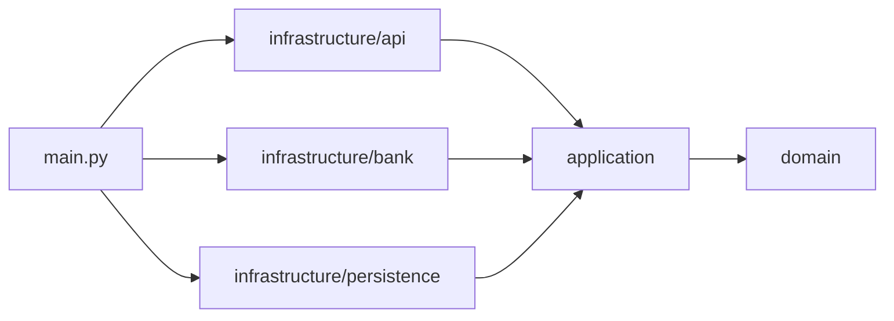

# Architecture

Clean Architecture, pragmatic, three rings (user decision 2026-10-22): `domain` (entities and rules), `application` (use cases and the interfaces they need), `infrastructure` (adapters and frameworks). No separate interface-adapters ring, presenters or per-use-case input/output models (NFR-05). One process, one container plus the bank simulator. Decisions: [ADR 0001](../adr/0001-rest-api-style.md) (REST level 2), [ADR 0002](../adr/0002-fastapi-pydantic-httpx.md) (FastAPI, Pydantic strict, httpx, uvicorn). Contract: [api.md](api.md).

The database and the bank are both treated as **external services** behind interfaces: the in-memory repository stands in for a database, and the bank adapter talks HTTP to the bank simulator (Mountebank, `imposters/bank_simulator.ejs`). Swapping either for a real one changes only `infrastructure/` and `main.py` (user decision 2026-10-22).

## Layers
Package: `payment_gateway_api/` (the starter's package, kept).

| Layer | Path | Responsibility | May import |
|---|---|---|---|
| Domain | `payment_gateway_api/domain/` | `Payment`, `PaymentStatus`, card rules (Luhn, masking, expiry), currency list, domain errors | stdlib only |
| Application | `payment_gateway_api/application/` | use cases `ProcessPayment`, `GetPayment`; interfaces `AcquiringBank`, `PaymentRepository` (`typing.Protocol`, dependency inversion) | domain |
| Infrastructure: api | `payment_gateway_api/infrastructure/api/` | FastAPI routes, Pydantic request/response models, exception handlers (inbound adapter) | application, domain, FastAPI, Pydantic |
| Infrastructure: bank | `payment_gateway_api/infrastructure/bank/` | `HttpAcquiringBank`: wire format, `asyncio.timeout`, httpx errors → domain error (outbound adapter) | application, domain, httpx |
| Infrastructure: persistence | `payment_gateway_api/infrastructure/persistence/` | `InMemoryPaymentRepository`, simulating a database (outbound adapter) | application, domain |
| Composition root | `payment_gateway_api/main.py` | builds the httpx client, adapters and use cases; creates the FastAPI app | everything |



## Dependency rules
- `domain/` and `application/` never import `fastapi`, `pydantic` or `httpx`: the core must be testable without I/O or frameworks.
- `infrastructure/api` never imports `infrastructure/bank` or `infrastructure/persistence`: it only calls use cases.
- Only `main.py` instantiates adapters; nothing does work at import time.
- Business rules are defined in `domain/`. The Pydantic validators in `infrastructure/api` call those domain functions and attach the A-08 error code; they do not reimplement the rules.

## Request flow (process a payment)
```mermaid
sequenceDiagram
  participant M as Merchant
  participant A as api (FastAPI + Pydantic)
  participant U as ProcessPayment
  participant R as PaymentRepository
  participant B as AcquiringBank
  M->>A: POST /payments (+ Cko-Idempotency-Key?)
  A->>A: validate (strict); on error 422 Rejected (A-08)
  A->>U: execute(request, idempotency_key)
  U->>R: find by idempotency_key
  alt key already stored
    R-->>U: payment
  else
    U->>U: new payment_id (UUID)
    U->>B: authorize(payment_id, card, amount) one call, 10s total
    alt bank failure
      B-->>U: BankUnavailableError → 503 Rejected (FR-13), nothing stored
    else authorized / declined
      U->>R: save(payment with masked card)
    end
  end
  U-->>A: payment
  A-->>M: 201 payment
```
`GET /payments/{id}` → `GetPayment` → `PaymentRepository.get` → `200` or `404` (A-10).

## External integrations
| System | Client in code | Direction | Notes |
|---|---|---|---|
| Bank simulator (Mountebank, `docker-compose.yml`) | `HttpAcquiringBank` in `infrastructure/bank/` | outbound HTTP `POST /payments` | sends `card_number`, `expiry_date` (`MM/YYYY`), `currency`, `amount`, `cvv`, `payment_id`; one call, 10 s total timeout, no retry (FR-13, NFR-06) |
| Database (simulated) | `InMemoryPaymentRepository` in `infrastructure/persistence/` | in-process | dict keyed by `id`, plus `idempotency_key` → `id`; lost on restart; single process only (ADR 0002) |

## Domain
| Business term | In code | Meaning |
|---|---|---|
| Payment | `Payment` | a processed payment: `id`, `status`, masked card number, expiry, currency, amount, optional `idempotency_key` |
| Status | `PaymentStatus` | `Authorized` or `Declined` for stored payments; `Rejected` is a response only, never stored (A-02) |
| Payment id | `Payment.id` | UUID created before the bank call; `payment_id` in the bank request and in logs (A-12) |

Invariants: a stored payment never holds the full card number or CVV (NFR-02, A-14); a stored payment's status is never `Rejected` (A-02).

## Security design
Targets: NFR-01, NFR-02 in [non-functional.md](../requirements/non-functional.md); classification: A-14.
- Card number and CVV exist only in the request model and the bank call; `Payment` stores the masked form only.
- Authentication: none, out of scope (assumptions.md, Out of scope).
- Never log: card number, CVV, the request body.
- Egress: the bank simulator only.

## Where new code goes
- New endpoint → route in `infrastructure/api/`, use case in `application/`.
- New validation rule → function in `domain/`, called from the request model's validator with its A-08 code.
- New external system → interface (`Protocol`) in `application/`, adapter in `infrastructure/<system>/`, wiring in `main.py`.
